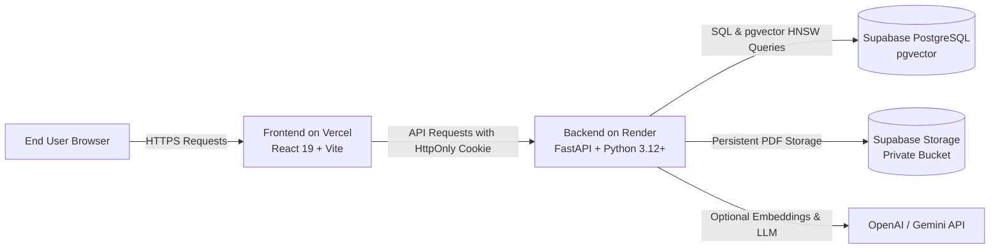

# Production Deployment Guide: AI Document Research Assistant

This guide provides step-by-step instructions for deploying the **AI Document Research Assistant** to production.

---

## 1. Recommended Production Architecture

| Component | Recommended Host | Why It Is Chosen | Cost Tier |
| :--- | :--- | :--- | :--- |
| **Database** | **Supabase PostgreSQL** | Already provisioned with `pgvector 0.8.2` and HNSW vector index; zero setup needed. | Free tier included |
| **Backend API** | **Render** (or Railway) | Native Python support, automatic HTTPS, zero-config process management, continuous deployment from GitHub. | Free / Starter ($7/mo) |
| **Frontend** | **Vercel** (or Netlify) | Global CDN, high performance, native Vite/React support, preview deployments. | Free tier included |
| **PDF Storage** | **Supabase Storage** (or Render Disk) | Private object storage bucket with zero additional vendor overhead; persists files across container restarts. | Free tier (1GB included) |



---

## 2. Environment Variables Specification

> [!CAUTION]
> **Never commit `.env` or production credentials to Git.** Configure environment variables strictly through your hosting provider dashboards (Render and Vercel).

### 2.1 Backend Environment Variables (Configure in Render / Railway Dashboard)

| Variable Name | Required | Example / Recommended Setting | Description |
| :--- | :--- | :--- | :--- |
| `ENVIRONMENT` | Yes | `production` | Enables production security mode and strict CSRF validation. |
| `APP_NAME` | No | `AI Document Research Assistant` | Display name of the application. |
| `DEBUG` | Yes | `false` | Disables verbose debug stack traces and public `/docs` in production. |
| `SECRET_KEY` | Yes | *(Generate 32-byte hex key)* | Secret key for signing JWT session tokens. |
| `CSRF_SECRET` | Yes | *(Generate 32-byte hex key)* | Secret key for signing and validating HMAC CSRF tokens. |
| `SESSION_COOKIE_NAME` | No | `doc_assistant_session` | Name of the HttpOnly session cookie. |
| `SESSION_MAX_AGE_SECONDS`| No | `604800` | Session lifetime (default: 7 days in seconds). |
| `COOKIE_SECURE` | Yes | `true` | Enforces that cookies are only sent over encrypted HTTPS. |
| `COOKIE_SAMESITE` | Yes | `lax` (with rewrites) or `none` (cross-domain) | Cookie cross-site policy. Set to `none` if frontend and backend use different domains. |
| `DATABASE_URL` | Yes | `postgresql+asyncpg://<user>:<password>@<host>:5432/postgres?ssl=require` | Connection string to your Supabase PostgreSQL pooler. |
| `CORS_ALLOWED_ORIGINS` | Yes | `https://your-app.vercel.app` | Comma-separated list of exact allowed frontend origins (no trailing slash). |
| `STORAGE_DIR` | No | `backend/storage/documents` | Directory where uploaded PDFs are stored on disk. |
| `MAX_FILE_SIZE_MB` | No | `25` | Maximum upload size limit per document. |
| `RETRIEVAL_TOP_K` | No | `6` | Number of most similar document chunks to retrieve per query. |
| `RETRIEVAL_SIMILARITY_THRESHOLD` | No | `0.60` | Minimum cosine similarity score required for retrieval. |
| `EMBEDDING_DIMENSION` | Yes | `1536` | Dimension of embedding vectors (must match HNSW index). |
| `EMBEDDING_PROVIDER` | Yes | `mock` (or `openai` / `gemini`) | Active embedding provider. |
| `LLM_PROVIDER` | Yes | `mock` (or `openai` / `gemini`) | Active language model provider. |
| `OPENAI_API_KEY` | Conditional | `sk-...` | Required only if `EMBEDDING_PROVIDER=openai` or `LLM_PROVIDER=openai`. |
| `GEMINI_API_KEY` | Conditional | `AIzaSy...` | Required only if `EMBEDDING_PROVIDER=gemini` or `LLM_PROVIDER=gemini`. |

### 2.2 Frontend Environment Variables (Configure in Vercel Dashboard)

| Variable Name | Required | Example Setting | Description |
| :--- | :--- | :--- | :--- |
| `VITE_API_URL` | Yes | `https://your-backend.onrender.com/api/v1` (or `/api/v1` if using rewrites) | Base API endpoint URL for the backend. |

---

## 3. Generating Production Security Secrets

Generate high-entropy random keys locally in PowerShell or Bash before configuring your dashboard:

### In PowerShell / Command Prompt:
```powershell
# Generate SECRET_KEY:
python -c "import secrets; print(secrets.token_hex(32))"

# Generate CSRF_SECRET:
python -c "import secrets; print(secrets.token_hex(32))"
```

### In Bash / macOS / Linux:
```bash
openssl rand -hex 32
```

---

## 4. Step-by-Step Deployment Instructions

### Step 4.1: Prepare Git Repository
Ensure your project is committed to a GitHub repository:
```bash
git init
git add .
git commit -m "feat: prepare production deployment configuration"
git remote add origin https://github.com/<your-username>/<your-repo-name>.git
git push -u origin main
```
Verify that `.env` is NOT tracked by running:
```bash
git status --ignored
```
Confirm `.env` appears under Ignored files.

---

### Step 4.2: Deploy Backend to Render

1. Log into [Render Dashboard](https://dashboard.render.com).
2. Click **New +** -> **Web Service**.
3. Connect your GitHub repository.
4. Configure the service settings:
   - **Name**: `ai-document-research-assistant-api`
   - **Region**: Choose a region close to your Supabase database (e.g., `Singapore` for AWS ap-southeast-2).
   - **Branch**: `main`
   - **Root Directory**: Leave blank (uses repo root).
   - **Runtime**: `Python 3`
   - **Build Command**:
     ```bash
     pip install -r backend/requirements.txt
     ```
   - **Start Command**:
     ```bash
     uvicorn backend.app.main:app --host 0.0.0.0 --port $PORT --workers 2
     ```
5. Click **Advanced**:
   - **Health Check Path**: `/health`
   - **Pre-Deploy Command** (runs database migrations automatically before traffic):
     ```bash
     alembic -c backend/alembic.ini upgrade head
     ```
6. Add the **Environment Variables** listed in Section 2.1.
7. Click **Create Web Service**.
8. Once deployment finishes, copy your live backend URL (e.g., `https://ai-document-research-assistant-api.onrender.com`).
9. Verify health in browser:
   `https://ai-document-research-assistant-api.onrender.com/health` -> should return `{"status":"healthy","service":"AI Document Research Assistant"}`.

---

### Step 4.3: Deploy Frontend to Vercel

1. Log into [Vercel Dashboard](https://vercel.com).
2. Click **Add New...** -> **Project**.
3. Import your GitHub repository.
4. Configure the project:
   - **Framework Preset**: `Vite`
   - **Root Directory**: Click "Edit" and select `frontend`.
   - **Build Command**: `npm run build`
   - **Output Directory**: `dist`
   - **Install Command**: `npm install`
5. Add **Environment Variables**:
   - Name: `VITE_API_URL`
   - Value: `https://ai-document-research-assistant-api.onrender.com/api/v1`
6. Click **Deploy**.
7. Once deployed, note your live Vercel URL (e.g., `https://ai-document-research-assistant.vercel.app`).

---

### Step 4.4: Connect CORS and Cookie Security

Now that both URLs are live:
1. Return to **Render Dashboard** -> **Environment**.
2. Update `CORS_ALLOWED_ORIGINS` to your exact Vercel URL:
   ```
   CORS_ALLOWED_ORIGINS=https://ai-document-research-assistant.vercel.app
   ```
3. Set cookie parameters for cross-domain HTTPS:
   ```
   COOKIE_SECURE=true
   COOKIE_SAMESITE=none
   ```
   *(Note: `COOKIE_SAMESITE=none` is required when frontend and backend use different domains on modern browsers).*
4. Click **Save Changes** (Render will automatically redeploy with the updated origins).

---

## 5. PDF Storage Persistence Strategy

### The Problem with Local Disk in Cloud Containers
Render, Railway, and other container platforms use **ephemeral filesystems**. Whenever your service redeploys, restarts, or wakes up from sleep, local files written inside the container (e.g. `backend/storage/documents/`) are **deleted**.

### Solution: Supabase Storage Private Bucket (Recommended)
Because Supabase is already utilized for PostgreSQL and pgvector, you can store PDF documents in Supabase Storage without adding new third-party vendors.

#### Manual Dashboard Setup Steps:
1. Open your [Supabase Project Dashboard](https://supabase.com/dashboard).
2. In the left navigation, click **Storage**.
3. Click **New bucket**:
   - Bucket name: `documents`
   - **Public bucket**: **DISABLED / OFF** (keeps all research files private).
   - Allowed MIME types: `application/pdf`
   - Maximum file size: `25MB`
4. Click **Save**.

#### Storage Adapter Architecture:
To route file operations to Supabase Storage:
- When uploading: The file is streamed to `storage.from('documents').upload(...)`.
- When streaming: Content is downloaded via `storage.from('documents').download(...)` or temporary authenticated signed URL.
- The `storage_path` column in `documents` stores the bucket object key (e.g. `<user_id>/<uuid>.pdf`).

> [!NOTE]
> Existing files stored on local disk during development will remain intact on your local machine. No files will be moved or deleted without your explicit command.

---

## 6. AI Provider Activation Guide

To switch from mock mode to real AI models in production:

### Option A: OpenAI (Recommended for RAG)
1. Generate an API key at [platform.openai.com](https://platform.openai.com).
2. In Render dashboard, set:
   ```env
   EMBEDDING_PROVIDER=openai
   EMBEDDING_MODEL=text-embedding-3-small
   EMBEDDING_DIMENSION=1536
   OPENAI_API_KEY=sk-...
   LLM_PROVIDER=openai
   LLM_MODEL=gpt-4o-mini
   ```
3. `gpt-4o-mini` is highly cost-efficient (~$0.15 per million input tokens) and adheres strictly to factual grounding rules.

### Option B: Google Gemini
1. Generate an API key at [aistudio.google.com](https://aistudio.google.com).
2. In Render dashboard, set:
   ```env
   EMBEDDING_PROVIDER=gemini
   EMBEDDING_MODEL=text-embedding-004
   GEMINI_API_KEY=AIzaSy...
   LLM_PROVIDER=gemini
   LLM_MODEL=gemini-1.5-flash
   ```

> [!IMPORTANT]
> The automated test suite (`pytest`) always uses `MockEmbeddingProvider` and `MockLLMProvider` regardless of your live configuration, ensuring automated testing never incurs API costs.

---

## 7. Post-Deployment Verification Checklist

After deploying both services, run through this verification checklist:

- [ ] **Liveness Check**: Open `https://<BACKEND-URL>/health`. Confirm response: `{"status":"healthy",...}`.
- [ ] **Readiness Check**: Open `https://<BACKEND-URL>/ready`. Confirm response: `{"status":"ready","database":"connected"}`.
- [ ] **Frontend Loading**: Open `https://<FRONTEND-URL>`. Confirm landing page renders with zero console errors.
- [ ] **User Registration**: Register a new user account. Confirm you are redirected to the Dashboard with an active session.
- [ ] **Document Upload**: Upload a sample PDF. Confirm status transitions to `READY`.
- [ ] **PDF Viewer**: Click the document to view. Confirm PDF pages stream and render correctly.
- [ ] **Chat Inquiry**: Open Workspace, select the uploaded document, and ask a question.
- [ ] **Citation Verification**: Verify the assistant response cites the exact document and page number.
- [ ] **Insufficient Evidence Gate**: Ask an unrelated question (e.g. "What is the speed of light?"). Confirm response returns insufficient evidence with 0 citations.
- [ ] **Security Check**: Open Developer Tools -> Application -> Cookies. Verify `doc_assistant_session` has:
  - `HttpOnly`: Checked
  - `Secure`: Checked
  - `SameSite`: `None` or `Lax`
